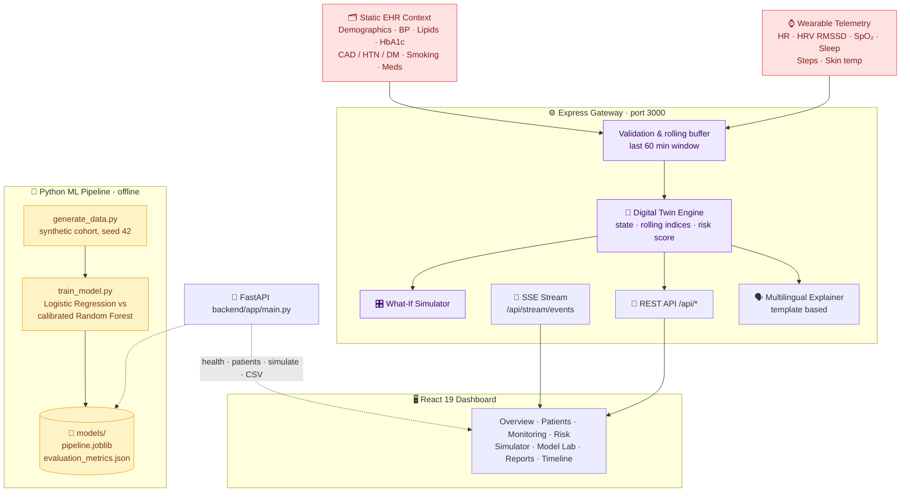
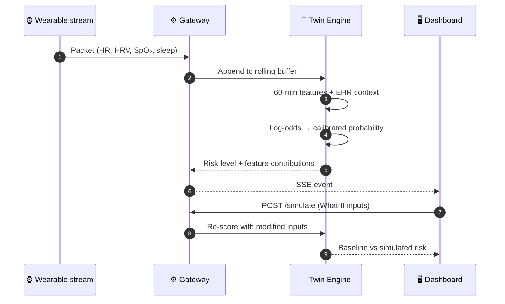
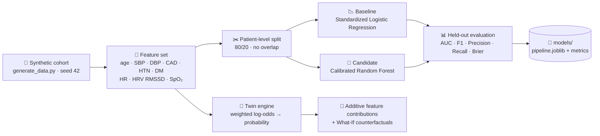

<div align="center">


<br/>

**EHR + wearable fusion &nbsp;·&nbsp; 2-hour risk forecast &nbsp;·&nbsp; What-If twin simulator &nbsp;·&nbsp; Explainable predictions**

<br/>

<a href="https://cardio-twin-ai-rose.vercel.app/">
  
</a>
&nbsp;
<a href="https://drive.google.com/file/d/1xtvKV2KIxVREqAI5D82XyuyLg4A64EDi/view?usp=sharing">
  
</a>

<br/><br/>


<br/>

### 🏆 Team INNOVATION NINJAS &nbsp;•&nbsp; 🎓 V.S.B College of Engineering Technical Campus
**Happiest Health Digital Twin Challenge 2026**

<br/>

[🌐 Live Demo](https://cardio-twin-ai-rose.vercel.app/) &nbsp;│&nbsp;
[🎬 Demo Video](https://drive.google.com/file/d/1xtvKV2KIxVREqAI5D82XyuyLg4A64EDi/view?usp=sharing) &nbsp;│&nbsp;
[✨ Features](#-features) &nbsp;│&nbsp;
[🏗️ Architecture](#️-architecture) &nbsp;│&nbsp;
[🤖 AI/ML](#-aiml-approach) &nbsp;│&nbsp;
[🚀 Quick Start](#-quick-start) &nbsp;│&nbsp;
[📡 API](#-api-reference) &nbsp;│&nbsp;
[👥 Team](#-team)

<br/>

</div>

---

<div align="center">

## 🩺 The Problem We Solve

*Cardiology is episodic. Patients are not.*

</div>

<div align="center">

A blood-pressure reading here, an ECG there, months apart. Between visits, autonomic strain, restless nights and rising resting heart rate go unseen until something happens.
**CardioTwin AI** closes that gap with a **patient-specific digital twin** that fuses long-term **EHR context** with a **continuous wearable stream**, tracks **HRV (RMSSD)** and **resting heart rate**, and estimates the chance of an **elevated physiological-pattern risk in the next 2 hours**.

<br/>

<table>
<tr>
<td align="center" width="25%"><h3>🧬</h3><b>Digital Twin</b><br/><sub>A virtual patient that updates with every sensor packet</sub></td>
<td align="center" width="25%"><h3>📡</h3><b>Live Telemetry</b><br/><sub>Server-Sent Events stream with start, pause and reset</sub></td>
<td align="center" width="25%"><h3>🔮</h3><b>2-Hour Forecast</b><br/><sub>Risk probability with feature contributions</sub></td>
<td align="center" width="25%"><h3>🎛️</h3><b>What-If Lab</b><br/><sub>Test sleep, BP, heart rate and adherence changes</sub></td>
</tr>
</table>

</div>

<div align="center">

> ⚠️ **Prototype notice:** all patients and sensor data are **synthetic**. This is an educational proof of concept, not a diagnostic tool or medical device.

</div>

---

<div align="center">

## 📌 At a Glance

| 👥 Synthetic patients | 🪟 Feature window | ⏱️ Forecast horizon | 🌍 Languages | 🖥️ Dashboard pages |
|:---:|:---:|:---:|:---:|:---:|
| **10** | **60 min** | **2 hours** | **6** | **13** |

</div>

---

<div align="center">

## ✨ Features

</div>

<div align="center">

| | Feature | What it does |
|:---:|:---|:---|
| 📊 | **Executive overview** | Real-time vitals, rolling HR/HRV trends and a canvas-drawn lead II ECG strip |
| 👥 | **Patient digital twins** | Registry of 10 synthetic patients with EHR profile: BP, lipids, HbA1c, CAD / hypertension / diabetes, smoking status |
| 📡 | **Live wearable monitoring** | Streaming HR, HRV, SpO₂, sleep, steps and skin-temperature deviation with speed control and a packet inspector |
| 🧠 | **AI risk intelligence** | Calibrated 2-hour risk probability, odds ratios and additive per-feature contributions |
| 🎛️ | **What-If simulator** | Counterfactual runs on sleep, blood pressure, heart rate and medication adherence |
| 🧪 | **Model Performance Lab** | ROC and PR curves, confusion matrix and feature importances |
| 🚨 | **Alerts & notifications** | Configurable thresholds, notification drawer and history |
| 🗣️ | **Multilingual explainer** | Patient-friendly explanations in English, Tamil, Hindi, Malayalam, Telugu and Kannada |
| 📄 | **Reports & export** | Printable twin dossiers and per-patient wearable CSV export |
| ⌨️ | **Productivity** | Command palette, keyboard shortcuts, light / dark theme, responsive layout |

</div>

---

<div align="center">

## 🏗️ Architecture

</div>



<div align="center">

### 🔁 Data & Prediction Flow

</div>



<div align="center">

### 🎯 Prediction Target & Leakage Control

| | |
|:---|:---|
| **Target** | *Elevated physiological-pattern risk within the next 2 hours* (simulated dataset) |
| **Definition** | Sustained resting tachycardia (> baseline + 25 bpm), depressed HRV (RMSSD < 25 ms) and sleep deficit (< 5.5 h) |
| **Feature window** | Trailing 60 minutes of telemetry plus static EHR |
| **Forecast window** | Strictly the next 120 minutes; no future data enters the features |
| **Split** | Patient-level 80/20 partition with no patient overlap |

</div>

---

<div align="center">

## 🤖 AI/ML Approach

</div>



<div align="center">

| Stage | Approach |
|:---|:---|
| **Problem framing** | Binary classification: elevated physiological-pattern risk in the next 2 hours |
| **Data** | Synthetic EHR + wearable observations with circadian variation; deterministic seed |
| **Features** | Static EHR (age, BP, CAD / HTN / DM) and dynamic telemetry (HR, HRV RMSSD, SpO₂). The live twin adds 60-minute rolling windows, sleep deficit and LDL/HDL ratio |
| **Models** | Standardized Logistic Regression baseline vs calibrated Random Forest |
| **Validation** | Patient-level partition to prevent leakage across one person's samples |
| **Metrics** | ROC-AUC, F1, precision, recall, accuracy, Brier score, confusion matrix |
| **Explainability** | Per-feature additive contributions and odds ratios beside every prediction |
| **Counterfactuals** | What-If simulator re-scores the twin after changing sleep, BP, heart rate or adherence |
| **Language layer** | Template-based patient-friendly explanations in six languages |

</div>

---

<div align="center">

## 🧰 Tech Stack

</div>

<div align="center">

| Layer | Technology |
|:---:|:---|
| 🎨 **Frontend** | React 19 · TypeScript · Vite 8 · Tailwind CSS 4 · Recharts · Motion · Lucide Icons · i18next · HTML5 Canvas (ECG) |
| ⚙️ **Gateway** | Node.js · Express 4 · Server-Sent Events · `tsx` · dotenv |
| 🐍 **Python API** | FastAPI · Pydantic |
| 🧪 **ML / Data** | scikit-learn · pandas · NumPy · joblib |
| ✨ **Optional AI SDK** | `@google/genai` (installed, not yet called) |
| 🛠️ **Tooling** | TypeScript · npm / Bun · Python test script |
| ☁️ **Hosting** | Vercel |

</div>

---

<div align="center">

## 🚀 Quick Start

**Prerequisites:** Node.js 18+ &nbsp;•&nbsp; Python 3.10+ (only for the ML pipeline and FastAPI service)

</div>

```bash
# 1. Clone and run the app
git clone https://github.com/sathi2305/CardioTwin-AI-.git
cd CardioTwin-AI-
npm install
cp .env.example .env
npm run dev                      # → http://localhost:3000
```

<details>
<summary><b>🐍 Rebuild the dataset and model (optional)</b></summary>

```bash
pip install fastapi pydantic scikit-learn pandas numpy joblib
python backend/scripts/generate_data.py
python backend/scripts/train_model.py
```

</details>

<details>
<summary><b>⚙️ Environment variables</b></summary>

| Variable | Default | Purpose |
|:---|:---|:---|
| `PORT` | `3000` | Server port |
| `VITE_API_BASE_URL` | *(empty)* | API base URL for the frontend |
| `GEMINI_API_KEY` | *(empty)* | Reserved for the explainer (see Model Results & Transparency) |
| `APP_URL` | *(empty)* | Public app URL |

</details>

<details>
<summary><b>✅ Quality checks</b></summary>

```bash
python backend/tests/test_api.py    # 3 tests
npm run lint                        # tsc --noEmit
npm run build
```

</details>

---

<div align="center">

## 📡 API Reference

</div>

<div align="center">

| Method | Endpoint | Description |
|:---:|:---|:---|
| `GET` | `/api/health` | Service health and version |
| `GET` | `/api/patients` | List synthetic patients |
| `GET` | `/api/patients/:id` | One patient's EHR profile |
| `GET` | `/api/patients/:id/wearables` | Recent sensor observations |
| `GET` | `/api/patients/:id/twin` | Current digital twin state |
| `GET` | `/api/patients/:id/prediction` | 2-hour risk prediction and contributions |
| `POST` | `/api/patients/:id/simulate` | What-If counterfactual simulation |
| `GET` | `/api/model/metrics` | Model evaluation metrics |
| `GET` | `/api/model/info` | Target, horizon and leakage protocol |
| `GET` | `/api/stream/status` | Stream state |
| `POST` | `/api/stream/start` · `/pause` · `/reset` | Stream controls |
| `GET` | `/api/stream/events` | SSE telemetry stream |
| `GET` | `/api/reports/:patient_id/wearables.csv` | CSV export |
| `POST` | `/api/ai/multilingual-explain` | Localized explanation of a patient's trend |

</div>

---

<div align="center">

## 📁 Project Structure

</div>

```text
CardioTwin-AI-/
├── server.ts                    # Express gateway, SSE stream, REST API
├── src/
│   ├── pages/                   # Overview, Patients, Monitoring, RiskAnalysis,
│   │                            # Simulator, ModelLab, Reports, Timeline, Docs ...
│   ├── components/              # charts (ECG, HR, HRV, ROC, confusion matrix),
│   │                            # layout, monitoring, twin, ui
│   ├── utils/digitalTwinEngine.ts   # twin state, risk scoring, What-If
│   ├── data/                    # synthetic patients, model metrics
│   ├── i18n/                    # en · ta · hi · ml · te · kn
│   ├── services/                # API client, stream client
│   └── context/                 # theme, language, sidebar
├── backend/
│   ├── app/main.py              # FastAPI service
│   ├── scripts/                 # generate_data.py, train_model.py
│   └── tests/test_api.py
├── data/generated/              # synthetic wearable dataset
├── models/                      # trained pipeline + evaluation_metrics.json
├── CardioTwin_AI_Architecture_Diagram_Enhanced.pdf
└── CardioTwin_AI_Challenge_Presentation (1).pptx
```

---

<div align="center">

## 📊 Model Results & Transparency

Metrics from the training script's own output, `models/evaluation_metrics.json` (10 synthetic patients, 2,880 observations, 576 held-out):

| Model | ROC-AUC | F1 | Precision | Recall | Brier |
|:---|:---:|:---:|:---:|:---:|:---:|
| Logistic Regression baseline | 0.816 | 0.760 | 1.000 | 0.613 | n/a |
| Calibrated Random Forest | 0.816 | 0.765 | 1.000 | 0.619 | 0.121 |

</div>

> **Please read:**
> - These are scores on **synthetic data whose label is defined by rules over the same features**, so they show the pipeline works. They say nothing about real-world clinical accuracy.
> - The **Model Lab page and `/api/model/metrics`** display a separate set of figures (ROC-AUC 0.891, 14,400 observations, 20 patients) stored as constants in `src/data/modelEvaluation.ts`. They are not the output of `train_model.py`, and the ROC/PR curves there are hand-entered. Treat that page as an illustrative mock-up until it is wired to the real metrics.
> - The **live risk score** comes from a hand-weighted logistic formula in `digitalTwinEngine.ts`; the trained `.joblib` pipeline is not loaded by the server.
> - The **multilingual explainer** uses template text; no Gemini call is made yet, even when `GEMINI_API_KEY` is set.

---

<div align="center">

## 🌐 Deployment

**Live now:** [**cardio-twin-ai-rose.vercel.app**](https://cardio-twin-ai-rose.vercel.app/)

</div>

- Hosted on **Vercel**.
- `npm run build` produces the static dashboard; `npm run dev` or `npm start` runs the full Express gateway with SSE.

---

<div align="center">

## ⚖️ Limitations & Ethics

</div>

| | |
|:---|:---|
| 🩺 **Non-diagnostic** | Educational prototype; it does not diagnose, prescribe or replace a cardiologist |
| 🧪 **Synthetic data** | Distributions are not clinically validated |
| ⌚ **Sensor artifacts** | PPG is sensitive to motion |
| 🔗 **Correlation, not causation** | Feature contributions show statistical weight only |

---

<div align="center">

## 🗺️ Roadmap

</div>

<div align="center">

| Status | Item |
|:---:|:---|
| ✅ | Digital twin, live stream, What-If simulator, reports |
| ✅ | Synthetic data generator and training pipeline |
| 🔜 | Serve the trained model from the API and show its real metrics in the Model Lab |
| 🔜 | `requirements.txt` and CI for the Python tests |
| 🔜 | LLM-backed multilingual explanations |
| 💡 | FHIR / HL7 integration and on-device inference |
| 💡 | Multi-lead ECG arrhythmia classification and prospective validation |

</div>

---

<div align="center">

## 🤝 Contributing

**Fork** → **Branch** (`feature/your-idea`) → **Commit** → **Push** → **Open a Pull Request**

<br/>

## 📄 License

Released under the **[MIT License](LICENSE)**.

</div>

---

<div align="center">

## 👥 Team

### 🥷 INNOVATION NINJAS

<br/>

| Role | Name |
|:---:|:---|
| 👑 **Team Leader** | **Sathiyamoorthi S** · [@sathi2305](https://github.com/sathi2305) |
| 🤝 **Team Member** | **Omprakash S** |

<br/>

🎓 **V.S.B College of Engineering Technical Campus**

<br/>

[🎬 Watch the demo video](https://drive.google.com/file/d/1xtvKV2KIxVREqAI5D82XyuyLg4A64EDi/view?usp=sharing) &nbsp;•&nbsp; [🌐 Open the live platform](https://cardio-twin-ai-rose.vercel.app/)

<br/>

> ⚠️ **Disclaimer:** CardioTwin AI is a research prototype using synthetic data. It is not medical advice and must not be used for diagnosis or treatment.

<br/>

<a href="https://cardio-twin-ai-rose.vercel.app/">
  
</a>

<br/><br/>

**⭐ If this project is useful, please star the repo! ⭐**

<sub>Made with ❤️ by Team INNOVATION NINJAS · V.S.B College of Engineering Technical Campus<br/>Happiest Health Digital Twin Challenge 2026</sub>


</div>
